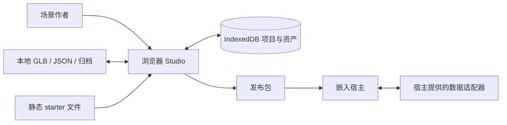
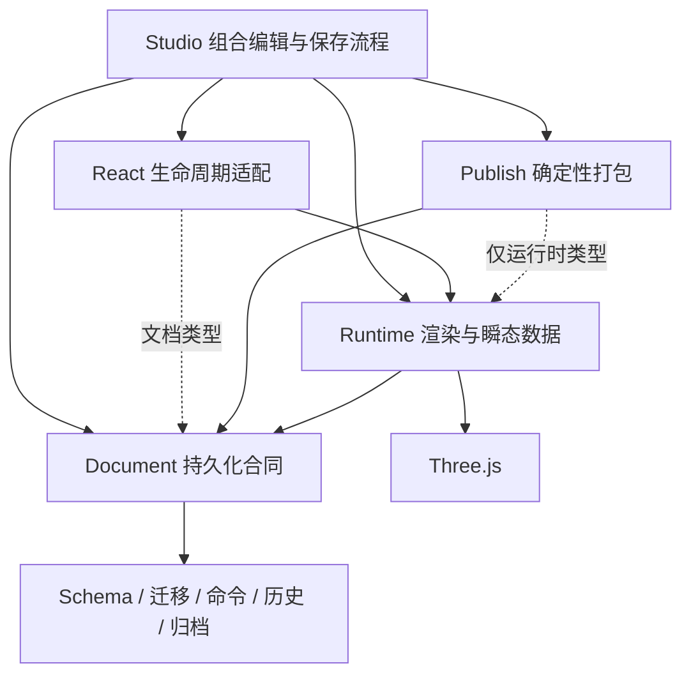

# SceneWeave 架构与风险审查（历史基线）

日期：2026-10-25。审查基线：`main@0c5de5d92712ffbb76be7330fe54896040d0ad31`，开始与结束工作树均干净。

结论：现有包分层与持久化文档的归属清楚，适合继续迭代。该基线确认 4 项 P1、2 项 P2，主要集中在保存与输入边界。建议先修这些合同，再做局部重构；没有证据支持全面重写或仅按行数拆文件。该次审查只读，未修改、提交或推送产品。后续修复状态见[改造过程与决策](remediation-log.md)。

下列源码位置和行号均描述该历史基线，当前修复后行号可能不同；当前状态见[改造日志](remediation-log.md)。

## 优先处理的风险

### R1 · P1：撤销新模型导入后，当前项目无法保存

- 位置：[导入后保留资源池](../../../apps/studio/src/workspace/useStudioWorkspace.ts)（历史基线第 507 行）、[撤销](../../../apps/studio/src/workspace/useStudioWorkspace.ts)（历史基线第 338 行）、[快照替换](../../../apps/studio/src/project/project-name.ts)（历史基线第 5 行）、[仓库输入限制](../../../apps/studio/src/project/indexeddb-project-repository.ts)（历史基线第 60 行）。
- 触发：导入原文档没有的新模型，再撤销。文档已移除资产，但活动快照仍携带该 Blob；repository.save 拒绝“不被当前文档引用”的输入资产。
- 实证：真实 history、快照 helper、autosave 与 fake-indexeddb-backed repository 组合探针中，导入 r1 成功；撤销 r2 时 documentAssets=0、snapshotAssets=1，保存及 autosave.flush 被拒；数据库仍有撤销前的模型。撤销后改名也不能保存。切换、导出先等待同一 flush，因而受阻。
- 原因：同一 assets 字段同时承担“历史可用字节池”和“当前文档持久化输入”两种含义。
- 最小修正：在 Studio 保存边界生成仅含当前引用资产的持久化投影，内存/已存储资源继续供 redo 使用。不要直接删除 redo 需要的 Blob，也不要放松仓库完整性校验。探针中的过滤投影已证明可保存撤销结果且 redo 仍可保存；产品尚未修复。
- 验证：用真实 repository 接入 workspace 测试 import→undo→autosave→继续编辑→切换/导出→reopen；另走 redo。现有 undo-import 测试的宽松 save mock 未覆盖真实限制。
- 证据：Demonstrated；可信度高；修复复杂度低至中。

### R2 · P1：两个标签页的陈旧保存可覆盖已保存内容

- 位置：`apps/studio/src/project/indexeddb-project-repository.ts:84,110,121,123`；`apps/studio/src/workspace/useStudioWorkspace.ts:163,245`。
- 触发：两个标签页打开同一项目，各自有 autosave 队列；初始化锁不覆盖后续编辑。save 在事务里读取 existing，但无基于存储版本的冲突校验，直接覆盖 documentJson。
- 实证：两个真实 repository 实例共享 fake IndexedDB，A 从 r0 保存到 r2，B 从旧 r0 保存 r1 被接受，重新读取变为 B/r1。相同 revision 的不同分支也可覆盖。探针 1 test 通过表示“不安全行为已复现”，不是安全验收。
- 影响：另一页已保存的修改可能静默丢失。此问题不同于上一轮已修复的同页 export acknowledgement 和项目切换竞争。
- 最小修正：OpenSpec 明确单写入者策略，或在同一存储事务中比较并递增存储版本/token，冲突时保留本地副本并提示重新打开/另存。只比较 document.revision 不足以识别同 revision 分叉，无须为此建设云协同服务。
- 验证：旧 revision、同 revision 分叉、独立项目、冲突副本恢复；补真实双标签页操作与刷新持久化检查。
- 证据：Demonstrated（存储层）；可信度高；复杂度中。未做真实双标签页界面复现。

### R3 · P1：GLB 可绕过外部资源限制

- 位置：`packages/runtime/src/assets/inspect-gltf.ts:49,92,130`；`packages/runtime/src/assets/asset-loader.ts:48,63,79`。
- 触发：GLB 只校验头部，未对 JSON chunk 执行文本 glTF 的外链政策；GLTFLoader 可访问其中的外部 buffer/image。运行时也只校验外层文件长度和哈希。
- 实证：388 字节 GLB 引用外部 buffer，inspectGltf 成功且 fetch 拦截器记录资源请求；相同 JSON 作为 .gltf 被拒。请求被本地 mock 接住，没有实际联网。
- 影响：外部子资源不在外层 SHA-256、byteLength 与资源解析器的控制范围，破坏自包含、可复现及大小预算约束。未证明 SSRF、凭据窃取、脚本执行或跨域任意读取；浏览器/CORS 限制依然适用。
- 最小修正：GLB JSON chunk 和文本 glTF 使用统一资源政策；Studio 检查与 runtime/archive 播放入口均在 parse 前执行，loader 子资源解析做防御性限制。
- 验证：GLB 外部 buffer/image 在发请求前拒绝；runtime/archive/publish 入口覆盖；有效嵌入资源仍兼容，稳定 hash/nodeIndex 含义保持。
- 证据：Demonstrated；可信度高；复杂度中。

### R4 · P1：畸形 ZIP 可绕过解压预算

- 位置：`packages/document/src/archive/zip.ts:56,82,97,134`；已安装 fflate 的 unzipSync 使用 EOCD +8 字段，预检使用 +10。
- 触发：让 EOCD 本磁盘条目数与总条目数不一致，并把目录声明长度缩到第一条；预检只检查良性 manifest，unzipSync 仍解压第二个未检查条目。
- 实证：52,418 字节压缩包通过 decodeArchiveZip，隐藏条目解压为 53,477,376 字节（51 MiB），超过 50 MiB 单文件预算，最终输出 Map 只保留 manifest。无须有效业务 manifest 即可先触发分配；后续业务拒绝发生在解压之后。
- 影响：不可信归档可消耗超出预期的主线程 CPU/内存。已证明预算绕过，未证明代码执行、文件系统写入或信息外泄。未扩大危险负载规模。
- 最小修正：拒绝不支持的分磁盘/计数不一致头部，绑定完整目录边界与实际待解压条目；解压只允许已校验条目，不能仅补一个数字比较后假定安全。
- 验证：畸形计数、隐藏目录条目、ZIP64 与单文件/总预算在分配前拒绝；保留正常归档确定性往返。
- 证据：Demonstrated；可信度高；复杂度中。

### R5 · P2：dispose 完成不代表全部加载已结束

- 位置：`packages/runtime/src/viewer/three-scene-viewport.ts:317,858`；`packages/runtime/src/assets/asset-loader.ts:46`；`docs/architecture.md:43`。
- 实证：自定义 resolver 已进入但不响应取消，await viewer.dispose() 已完成，load 仍 pending；释放 gate 后才以 AbortError 结束。renderer fake 探针 1 passed / 31 skipped。
- 影响：宿主不能把 dispose Promise 当作全部加载结清的严格屏障，与当前文档承诺不一致。已有取消检查会阻止过时 generation 提交，最终也会清理；未证明 GPU 泄漏或销毁后可见修改。
- 最小修正：明确协作式取消、超时/脱离与最终清理的合同；保持及时释放 renderer，暴露准确的异步结清语义。盲等任意 resolver 可能永久挂起，不能作为完整修复。
- 验证：慢 resolver、慢 parse、排队 load、重复 dispose 和 StrictMode 重挂载；真实 GPU 内存需另行测量。
- 证据：Demonstrated（限定测试条件）；可信度高；复杂度中。

### R6 · P2：普通编辑会逐实例重新读取和解析模型

- 位置：`packages/react/src/AuthoringScene.tsx:187`；viewport `:317–348`；`runtime-generation.ts:63,266`；`asset-loader.ts:48–79`。
- 代码路径：只有 light-only 更新有快速路径；改名、变换、锁定/可见性、热点/绑定等普通文档变更进入完整 generation 构建。每个 asset entity 分别读字节、哈希、GLTF parse，相同模型的多个实例也重复。
- 影响：编辑成本随整个场景和实例数增长；旧/新 generation 在提交前并存。当前恢复场景为 71 实例/49 模型，该数字不是性能测试结果。相机连续性已修复，全量重建成本仍存在。
- 最小修正：先记录 parse 次数、edit→ready 耗时、峰值资源；按文档元信息/变换/属性定义可增量更新类型，再决定是否引入按 hash 的、具有明确生命周期的原型复用。保留原子完整替换作为回退。
- 验证：支持的改名/变换不重解析未变模型；失败保留旧场景；稳定节点身份、材质隔离、实例资源释放均不退化；真实浏览器/设备再验证收益。
- 证据：Supported（实际调用链）；重复工作可信度高；复杂度中至高。未测 FPS、长会话内存或 OOM，不能声称已经卡顿/泄漏。

## 当前架构

### 系统上下文

当前仓库没有应用后端。发布包由宿主读取，适配器与可信内容由宿主提供。

### 组件依赖

应保留：Document 作为持久化含义的归属；runtime/session 状态与持久化分离；稳定 Target 的 assetHash+nodeIndex；原子候选 generation 提交；公开包入口与显式迁移；已经修复的导出元数据确认和同页替换/导入锁。依赖枚举未发现包级环；publish→runtime 是类型边，不能误判为运行时循环。

## 重构候选与推进顺序

1. **保存边界与写入权威（优先，R1/R2）**：将活动字节池与持久化输入含义明确；确定跨页冲突政策。私有 helper 和存储合同修正即可，无须改文档 schema。进入实现前要独立比较两种写入政策、形成 OpenSpec 和保存不变量。
2. **输入验证边界（R3/R4）**：统一 GLB/glTF 资源政策，校准 ZIP 预检与实际解压的同一条目集合。可分 GLTF 与 ZIP 两条独立开发/审查子代理；保留有效模型与归档兼容性。
3. **异步生命周期合同（R5）**：先决定 dispose 的取消与结清语义，再做局部提取或实现；不以拆 viewport 文件代替所有权设计。
4. **增量编辑与资源复用（R6）**：先建立真实测量基线，再提交范围有限的性能方案。保持材质隔离、节点身份及原子回退。

App 的 hook 组合本身合理；不按 887 行或 viewport 的 1302 行机械拆分。execute/undo/redo 的五处状态同步有局部重复但尚无分歧，仅 P3 同区域维护观察，可在修 R1 时顺带抽取，不另计功能风险。

审查时建议先落实每阶段的 OpenSpec proposal/design/tasks/spec 场景，再实施局部修正。保存与输入修复需要真实组合测试和可见浏览器验收，不能只沿用宽松 mock。该建议现已进入三项修复，状态与决策见[改造过程与决策](remediation-log.md)。

## 核验与覆盖边界

- 使用技能：architect-codebase-review、code-audit、reviewing-code-modularity-skill；先建立代码地图，再分别检查代码健康、跨模块一致性、重构机会、安全与性能，最后复核高优先级结论。
- 全量枚举 419 个代码/样式/工具文件，其中 153 个 test/spec 文件；扫描 1,586 个 import 观察。此为枚举/依赖扫描，不能声称逐行审查 419 个文件；未使用不可用的 CodeGraph。
- 9 组直接 tsc --noEmit 与 eslint 全通过。未运行会生成文件的 pnpm 生命周期 hooks，未安装依赖。
- 五个有界探针经过独立复跑：undo-import 模块组合、双 writer 存储、GLB 外链拦截、ZIP 计数绕过、dispose 条件测试，结果一致。探针通过指风险复现成功。
- 本轮未重跑全套单测，未进行新浏览器验收、真实 GPU profile、持续内存/大场景 benchmark 或依赖漏洞库扫描。上一轮 839 测试与浏览器验收仅代表当时变更范围，不能替代本轮的完整可靠性证明。
- 所有 P1 均核对源码及可重复结果。保存探针使用临时 fake IndexedDB；无真实用户数据库改写；GLB 网络被 mock；ZIP 负载限于 51 MiB。
- 没有证据支持 P0 定级。4 P1 / 2 P2 是本次审查的已确认发现数，不代表全仓其余部分无缺陷。

## 后续问题（未定为确认风险）

- 历史记录没有条数/字节预算，但使用结构共享，不能推断每次复制 GLB 或已经泄漏；需要长期会话量测。
- 发布/runtime 的响应存在先 arrayBuffer 后实际大小校验路径；若不可信远端托管纳入范围，应设计流式预算并作有界验证。
- 文档中的包依赖方向尚未发现自动强制门禁；可以补轻量 import 边界检查来保住现有结构。
- React 的部分选项只在挂载时采用；未发现当前调用方要求动态更新且被违反的合同，不作为缺陷。
- 依赖版本安全未查漏洞公告，不作安全无漏洞保证。

## 可追溯记录

四项专项审查归档在 [audit-lenses](audit-lenses/)，修复及永久回归命令见[改造过程](remediation-log.md)。基线缺陷复现数据保留为历史事实；当前回归测试验证修正后的合同，不会在当前源码上再次接受旧的不安全行为。

## 附：逐项架构原则评估

下表由跨模块 lens 提供；Security/Scalability/Lifecycle 的最终风险以本报告 R1–R6 为准。云多租户、AI 推理等不适用项没有强套到本地编辑器。

## Architecture principle coverage (this lens)

| Principle                      | Assessment                             | Evidence / applicability                                                                                                                                                                              |
| ------------------------------ | -------------------------------------- | ----------------------------------------------------------------------------------------------------------------------------------------------------------------------------------------------------- |
| Separation of Concerns         | Strength with composition pressure     | Public package ownership aligns with docs; App/workspace/viewport composition hotspots are investigated by health/refactoring lens.                                                                   |
| Cohesion and Coupling          | Strength, scoped                       | No workspace cycle in import scan; publish→runtime is type-only. No claim that all internal modules are minimal.                                                                                      |
| Layered Architecture           | Strength                               | document does not import app/runtime/react; runtime does not import React; Studio composes.                                                                                                           |
| Hexagonal / Ports and Adapters | Strength                               | Runtime AssetResolver/DataAdapter ports; Studio IndexedDB adapter; published host supplies adapters.                                                                                                  |
| Scalability                    | Partial / local limits apply           | Relevant axes are browser scene size, asset bytes, storage and main-thread cost. Cloud horizontal scaling/sharding N/A to current local browser product; performance lens owns profiling conclusions. |
| Observability                  | Strength, scoped                       | Typed diagnostics + UI save status/runtime events exist; no claim of full production tracing.                                                                                                         |
| Security                       | Partial                                | Canonical document/archive/hash validation is present. Trust boundaries and glTF/network details delegated to security/performance lens; no CVE conclusion.                                           |
| Reliability                    | Risk                                   | C1: independent writers accepted without conflict. Ordinary repository transaction and failure tests provide positive evidence for atomicity, not conflict safety.                                    |
| Resilience                     | Concern                                | Export/archive recovery exists; no cross-tab conflicting-copy recovery in C1. Regional disaster recovery N/A.                                                                                         |
| Data Architecture              | Risk + Strength                        | Document SSoT/asset hashes clear; storage write-authority absent across tabs (C1).                                                                                                                    |
| Cost Efficiency (FinOps)       | N/A cloud; partial browser             | No cloud/LLM billing subsystem. Browser asset/storage resource costs assessed separately.                                                                                                             |
| Operability                    | Strength, scoped                       | docs/architecture, SSoT/index, diagnostic contracts and reproducible commands exist; incident/on-call model not relevant to local library deployment.                                                 |
| Deployment Architecture        | Strength, scoped                       | `.github/workflows/ci.yml` runs frozen install/static/tests/build/release checks. Host deployments vary; no requirement for canary/cloud infrastructure in current scope.                             |
| Event Architecture             | Strength, scoped                       | Typed Viewer events and data envelopes (`runtime/types.ts`); ValueStore sequence/retired-stream guards (`data/value-store.ts:94–136`). Distributed event bus/DLQ N/A.                                 |
| AI Architecture                | N/A                                    | No product model/prompt inference subsystem identified.                                                                                                                                               |
| Multi-Tenancy                  | N/A                                    | No tenant/backend service identified; two browser tabs are local concurrency, not tenant isolation.                                                                                                   |
| Architecture Governance        | Strength                               | Explicit AGENTS boundaries, historical specs, OpenSpec change records; proposed change is distinct from accepted contract in index.                                                                   |
| Domain Architecture            | Strength                               | Neutral scene/document/data vocabulary; home content is reference data, not core schema terminology.                                                                                                  |
| API Architecture               | Strength, scoped                       | Public barrels, typed APIs and versioned SceneDocument migration; publish validates exact current version. React mount-option clarity remains a question only.                                        |
| Architecture Fitness Metrics   | Concern                                | Strong static/test/release gates; no enforced dependency-direction rule found in inspected lint/topology config.                                                                                      |
| Common Anti-Patterns           | No broad failure established           | No basis for calling the system a distributed monolith/big ball of mud. Current local write authority gap is specific.                                                                                |
| Testability                    | Strength with missing interaction case | Fake clocks/fake IDB/ports support deterministic tests. Current two-writer case absent and reproduced externally.                                                                                     |
| Evolvability                   | Strength, scoped                       | Versioned migration, commands, adapter/asset resolver ports and package edges support incremental change. Preserve these during targeted refactors.                                                   |
| Architectural Smells           | Concern limited to measured seams      | No generic OO/anemic-model complaint: pure functions are appropriate. Composition pressure handled by health lens; no mandatory Clean Architecture/DI rewrite.                                        |
