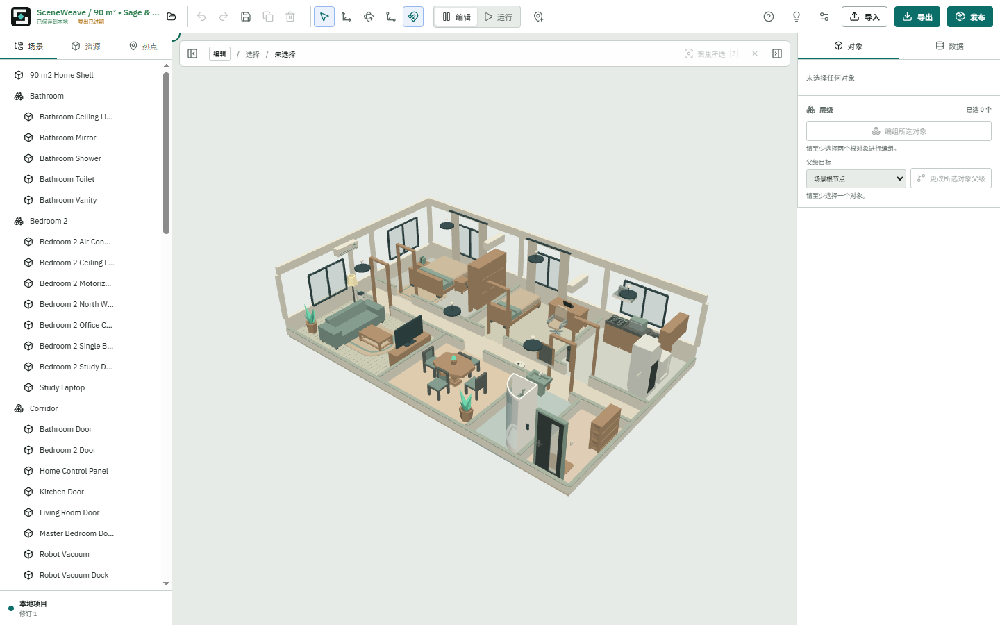
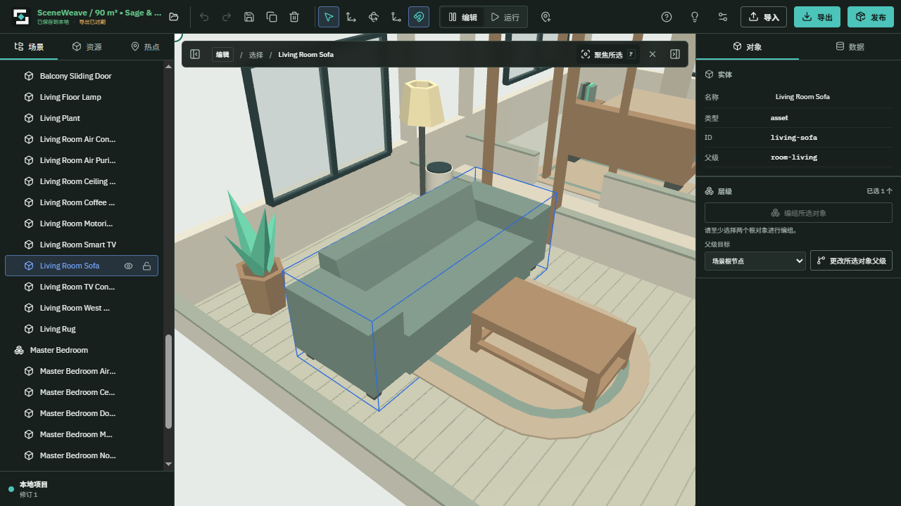
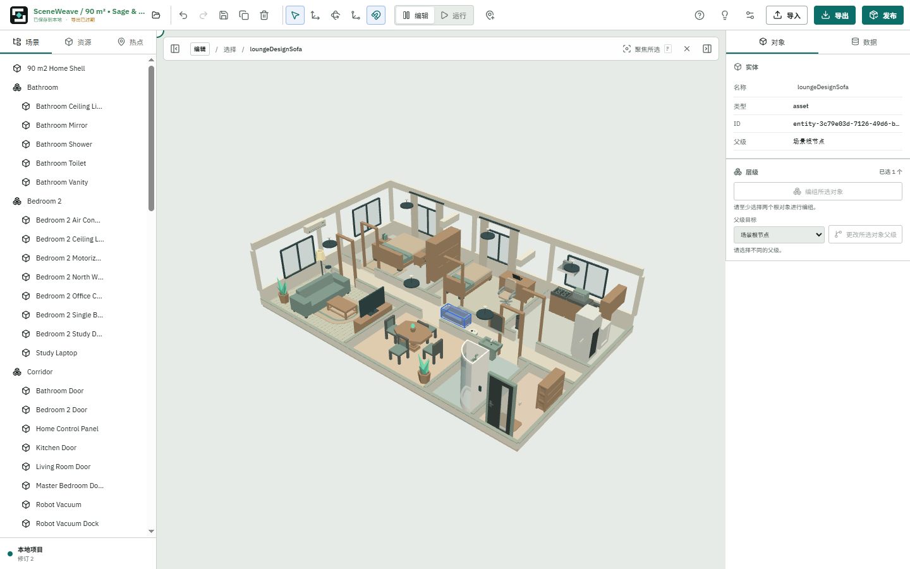
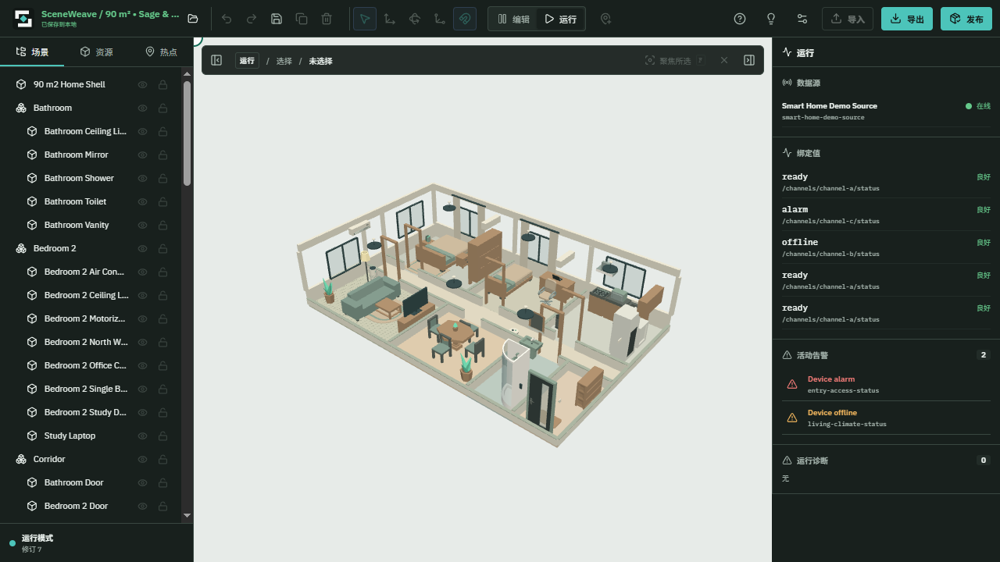

# 此前模型与编辑器交付审核（历史记录）

## 适用快照

本记录归档同日较早完成的免费家居与编辑器交付，不是本轮六风险修复的验收。工程审查基线为 `b92b25c7445d09935be054d4b8375293601cb827` 上的未提交验收快照；其四十二项工程文件 combined SHA-256 为 `5e6606efbb68ea875b1099af4817db8555f2c5ba062baf60304d000a492e5d06`。随后经过发布前文档清理形成 `main@0c5de5d`，本轮架构审查从该 main 开始。

历史工程文件身份见 [prior-engineering-source.json](evidence/prior-engineering-source.json)，资产 v2 的一百一十一路径见 [prior-asset-source.json](evidence/prior-asset-source.json)。它们记录当时审核的工作树/索引值，不声称当前修复后所有文件仍相同。四张代表性截图及哈希见 [prior-screenshots.json](evidence/prior-screenshots.json)。

方案和正式原交付合同见 [editor-quality-refresh](../../../openspec/changes/editor-quality-refresh/acceptance.md) 与 [free-home-starter](../../../openspec/changes/free-home-starter/acceptance.md)。本页将工程、资产、发布前检查及可见 QA 的判断放回项目内，避免只有外部报告路径。

## 工程独审最终结果

**PASS，仅限当时约定范围与冻结源码。** 无尚未解决的 P0/P1/P2。审查逐项核对四十二项源码及十九项证据身份，读取最终 diff、新 helper、测试和 OpenSpec，并独立运行五文件/八十项 focused 测试、Studio/runtime/E2E 直接类型检查和两项 OpenSpec strict。

当时完整单测为 127 文件 / 839 测试；typecheck、lint、build、i18n、topology、format 均通过，三个真实 gizmo E2E 通过。已有打包体积提示继续分类保留，未伪称无警告。

通过的合同包括：文件转换没有项目激活权、workspace 拥有 live history/session；导出完成只确认元数据而不回写旧文档；项目替换的最新请求权威和导入提交锁；ready 绑定当前 project/document/revision，Retry 明确重挂载；同文档编辑保留相机；默认 starter 为可离线分发的普通场景数据。

反向审查分别假设旧导出覆盖新编辑、刷新恢复错误项目、错误语义 mesh 着色、starter 只在本机存在、ready 代表空画布等故障，使用捕获与 live 历史/存储比较、LAST/最近项目断言、hash/index fixture、真实 Git 资产清单和实际可见渲染逐项反证。它未覆盖之后发现的跨标签页 CAS 或 undo-import 当前引用冲突，故历史 PASS 不能外推为全仓可靠。

## 资产独审最终结果

**资产/来源/许可/schema/target/构图范围 PASS。** 三十五个官方 Kenney 原始 GLB 的字节逐个与官方 ZIP 匹配，四十九个运行时模型从 vendored 输入与 authored 函数在内存重建，SHA 全部匹配；十四个补充模型有独立 authored CC0 声明。原始 Kenney 许可为 614 字节，SHA-256 `bc0de1a0742cb490f9ed4bae0bd284286ebb27e23149b9917c7d8c0d590b8b29`；authored 许可规范 LF 后为 510 字节，SHA `280c0ca89bef8b8f90082763532ed16d37ea50472a9ede9912a4e65535911af4`。免费清单未混入不可获得的旧外部私人模型。

默认归档为 1,045,464 字节，SHA-256 `85259024fddc28a5c0b52b2c4defb6dc25505c412ac60af61750202fbc6ee3f6`，普通 SceneDocument 1.4、五字段 starter 1.0。完整重导出在内存复现同一归档身份，四个 free-home 专项测试通过，模型 Khronos 验证零错误/零警告。

五个语义 target 保持准确 assetHash+nodeIndex：顶灯 2、空调 9、门锁 13、电视 2、机器人状态指示器 4。状态指示器未被误述为物理运动合同。完整户型视图经 canonical 导入仍为第一视图；前景阳台门/窗帘默认隐藏但实体和字节仍分发，语义设备保持可见。独审实际查看 1440×900、1280×720 全景及沙发聚焦图，确认构图完整和主体无遮挡，未从静态图声称 GPU/移动性能。

资产发布门禁曾发现 P1 集成缺口：最初 Git index 尚未包含八十四个新增 GLB，资产审计会漏掉它们。返工后实际 index 含八十七个模型（三十五源文件、四十九运行时、三个历史 fixture）、八十六唯一哈希，tracked 总计 1,515,964 字节，unique 1,514,748 字节。没有排除模型或放松验证器。独审运行两个 release 资产测试及 verify-assets，并用未清单模型、同长度字节变化、许可变化、tracked/unique 预算超限五种负例确认 fail closed。1,835,008 字节总上限按实测加 20% 并向 64 KiB 取整；单项上限与精确 hash 分开保留。

## 可见浏览器验收：十组主体流程

时间为 2026-10-25 14:09–14:12 Asia/Shanghai，普通本地 Studio、headful 系统 Chrome、新隔离 context。没有 test-starter 配置、业务 API/IDB 写入替代 UI，未使用个人 profile。开始和结束四十二项源码身份一致。

| 用户路径                        | 当时实际结果与判断                                                                                                  |
| ------------------------------- | ------------------------------------------------------------------------------------------------------------------- |
| 1440×900 首次打开               | 等真实 scene-ready、加载遮罩消失和连续稳定帧；整套户型与家具可见                                                    |
| 1280×720、明暗主题              | 无横向溢出；通过实际设置切主题，Escape 关闭后焦点返回设置按钮                                                       |
| 选择、聚焦、面板与键盘          | 沙发实际选择聚焦；左右栏可收起并用 Enter 恢复，canvas 范围相应变化                                                  |
| 改名、Undo/Redo、保存刷新       | 名称保存恢复；聚焦后改名前后实际场景区域 461,760 像素中 RGB 差异>10 的像素为零，支持相机不重置                      |
| 实际 gizmo 移动                 | 红轴拖动使 sofa X -4.25→-3.8900000107288366；Undo r6 还原，Redo r7 重做，保存刷新仍 r7/X -3.89，rotation/scale 不变 |
| Run/Edit                        | 数据源在线，ready/alarm/offline 真实显示，运行诊断零；前后下载作者文档完全相同                                      |
| 实际 JSON/ZIP 下载              | 真实 download 事件保存文件；导出 ZIP 1,045,487 字节、51 条目，含 manifest/scene 和模型                              |
| 已有项目不受 starter 不可用影响 | 对 starter 请求注入 503 后刷新已有项目，改名/位置保留，starter 请求零次                                             |
| 缺失 starter                    | 新 context descriptor 注入 404，出现清楚本地化失败与 Retry，无 canvas；解除后恢复完整场景                           |
| 损坏 starter                    | 归档注入损坏文本、HTTP200，应用拒绝；解除后通过 Retry 恢复                                                          |

正常流程 pageerror、console error、HTTP>=400 均为零；缺失 descriptor 的注入错误单列。首个脚本曾用整张 PNG 字节 SHA 判断相机相等、用选中前精确 accessible name 定位，分别遇到编码差异和名称变化；最终稳定截图/区域像素及稳定实体定位重新执行通过，未把失败尝试记为 PASS。

代表性历史图：





## 模型导入可见路径补验

时间为 14:14–14:16，1440×900，普通 toolbar/filechooser，四十二项源码前后相同。输入为 `assets/free-home/source/kenney/loungeDesignSofa.glb`，9,128 字节、SHA `b4f4e6850118e409da301df678228c703b6ac02e94fbb9dbde61543af817fa53`，区别于 starter 派生模型，真正经过新 hash 导入。

- 正常 inspection 摘要显示一节点、一 mesh、两材质、116 三角形和正确 SHA；取消后树 79→79、对话框不重开。
- 确认后树 79→80，实际新沙发可见选中；Undo→Redo→保存刷新保留同一实体 ID。该轮未在 Undo 与 Redo 之间保存，因此不能覆盖本轮 R1。
- 真实只读 MutationObserver 捕获 committing 时关闭/取消/确认均 disabled。提交很短，没有声称人工稳定看清或拍到该瞬间；延迟 hook 回归另行支撑锁行为。
- 非法 GLB 显示中文失败标题、确认不可用、取消可用，再选合法 GLB 可恢复。详细技术错误仍为英文，未宣称完全本地化。
- 独立 context 对 File.arrayBuffer 结果延迟 1500 ms，实际 UI inspection 中取消，晚 resolve 后对话框仍关闭、树仍 79。该项明确为 I/O 故障注入，没有写业务状态。

补验结果四组通过，pageerror/console/HTTP 失败列表为空。模型可见结果和 Run 状态示例：





## 发布前内容卫生审核

初轮发现公开 OpenSpec 混入内部调度、私有证据路径与工作台记录，退回清理后复核通过。范围为十份 OpenSpec Markdown 与 .gitignore 尾空行，十一项工作树/索引身份均匹配；三十三项原执行非 Markdown 不变量与一百零三项资产非 Markdown 字节不变。模型、归档、生成器、release inventory 和许可没有借文档清理改变。

公开记录保留需求、根因、设计、不变量、839 单测/三个 E2E/八十七模型门禁与仓库内可执行命令，删除私人账户路径、聊天标识、内部提示词和私有路径作为唯一证据。该审核本身未重新执行产品 QA、未提交或推送；后续实际发布身份由版本历史记录。

## 复验命令与边界

当前仓库可运行以下相应回归，但现在执行得到的是当前源码结果，不能回写历史测试数字：

```powershell
pnpm test
pnpm typecheck
pnpm lint
pnpm build
pnpm verify:i18n
pnpm verify:topology
node --test scripts/free-home/free-home.test.mjs
pnpm verify:assets
```

历史结论限定桌面 Chrome、相应输入与源码身份，不是全仓安全、所有并发调度、移动/XR、完整读屏、全部 TRS 或 GPU profile 的保证。损坏 bootstrap 有可见故障恢复；已入库模型 Blob 损坏未额外做真实浏览器注入。后续六风险审查与修复必须使用自己的证据，见[改造过程](remediation-log.md)。
